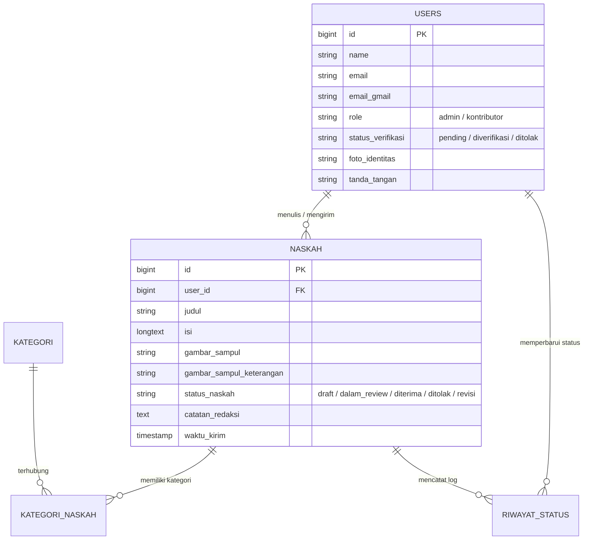

# 🗄️ Arsitektur - Database & Migrasi

Dokumentasi skema basis data, relasi tabel utama, dan migrasi penting yang telah dijalankan pada proyek Harian Cakrawala.

---

## 🔗 Relasi & Koneksi Sistem
- Induk: [[MOC - Harian Cakrawala]]
- Model Laravel: [[Arsitektur - Backend Laravel]]
- Pengguna & Dokumen: [[Modul - Kontributor & Verifikasi]]
- Naskah & Status: [[Modul - Review & Pengarsipan Naskah]]

---

## 📊 Relasi Tabel Utama

---

## 🚀 Migrasi Terbaru

1. **`2026_11_16_000001_add_foto_identitas_and_tanda_tangan_to_users_table.php`**:
   - Menambahkan kolom `foto_identitas` (string, nullable)
   - Menambahkan kolom `tanda_tangan` (string, nullable)
2. **`2026_11_16_000002_drop_abstrak_from_naskah_table.php`**:
   - Menghapus kolom legacy `abstrak` karena isi naskah kini langsung dikelola sebagai artikel utuh.
3. **`2026_11_16_000003_add_email_gmail_to_users_table.php`**:
   - Menambahkan kolom `email_gmail` untuk jalur kirim notifikasi verifikasi.
