# 🌐 Map of Content (MOC) - Sistem Harian Cakrawala

Selamat datang di peta dokumentasi arsitektur dan sistem pengarsipan media **Harian Cakrawala**. Halaman ini berfungsi sebagai simpul pusat (*hub*) pada **Obsidian Graph View** untuk menghubungkan seluruh modul teknis, bisnis, dan panduan operasional.

---

## 🧭 Navigasi Modul Sistem

```mermaid
graph TD
    MOC["MOC - Harian Cakrawala"]
    
    MOC --> MOD_SAMPUL["Modul - Gambar Sampul & Media"]
    MOC --> MOD_REVIEW["Modul - Review & Pengarsipan Naskah"]
    MOC --> MOD_KONTRIB["Modul - Kontributor & Verifikasi"]
    MOC --> MOD_PORTAL["Modul - Portal Berita Publik"]
    
    MOC --> ARCH_FE["Arsitektur - Frontend Vue"]
    MOC --> ARCH_BE["Arsitektur - Backend Laravel"]
    MOC --> ARCH_DB["Arsitektur - Database & Migrasi"]
    
    MOC --> GUIDE_CLAUDE["Panduan - Claude Code Handover"]
    MOC --> GIT_STATE["Git & Deployment State"]
    
    MOC -.-> DOC_CASE["manajement berita"]
    MOC -.-> DOC_SCOPE["Laporan Project Scope Pengelolaan Naskah Revisi"]
```

---

## 📦 Klaster Dokumen

### 1. Fungsional & Modul Utama
- [[Modul - Gambar Sampul & Media]] : Standardisasi upload, normalisasi URL cover, pencegahan bug placeholder.
- [[Modul - Review & Pengarsipan Naskah]] : Siklus hidup naskah, keputusan redaksi admin (Diterima, Ditolak, Revisi), catatan redaksi.
- [[Modul - Kontributor & Verifikasi]] : Pendaftaran, verifikasi berkas KTP & TTD, kirim naskah baru, pengajuan revisi draft.
- [[Modul - Portal Berita Publik]] : Landing page Cakrawala, navigasi kategori reaktif, layout berita headline.

### 2. Fondasi Arsitektur
- [[Arsitektur - Frontend Vue]] : Struktur Vue 3, Vite, Axios interceptor multipart, utility normalizer.
- [[Arsitektur - Backend Laravel]] : REST API Controllers, Sanctum, Mail Notification, Storage Public Link.
- [[Arsitektur - Database & Migrasi]] : Skema relasi naskah, kategori, user identitas, dan migrasi terbaru.

### 3. Operasional & Handover AI
- [[Panduan - Claude Code Handover]] : Panduan instruksi, aturan sintaks, dan workflow untuk melanjutkan sesi di Claude Code.
- [[Git & Deployment State]] : Riwayat commit terakhir (`3044a88`), branch `final` & `main`, hasil testing build.

### 4. Dokumen Riwayat Awal Proyek
- [[manajement berita]] : Catatan target dan case awal manajemen berita.
- [[Laporan Project Scope Pengelolaan Naskah Revisi]] : Ruang lingkup revisi naskah.

---
*Hubungan antar file di atas dapat dieksplorasi secara visual melalui fitur **Open Graph View** (`Ctrl + G`) di Obsidian.*
