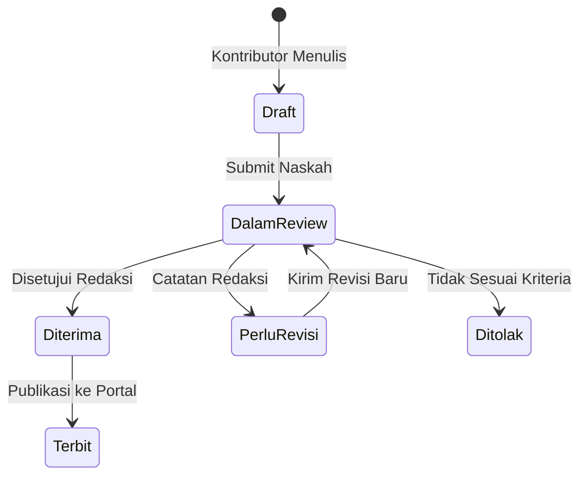

# 📝 Modul - Review & Pengarsipan Naskah

Modul ini adalah jantung operasional redaksi admin untuk menyeleksi, menyunting catatan, dan menentukan status naskah yang dikirim oleh kontributor maupun tamu publik.

---

## 🔗 Relasi & Koneksi Sistem
- Induk: [[MOC - Harian Cakrawala]]
- Alur Asal Naskah: [[Modul - Kontributor & Verifikasi]]
- Tampilan Sampul: [[Modul - Gambar Sampul & Media]]
- Penerbitan Berita: [[Modul - Portal Berita Publik]]
- Logika Backend: [[Arsitektur - Backend Laravel]] (AdminReviewController)
- Antarmuka Admin: [[Arsitektur - Frontend Vue]] (KelolaNaskahView, DetailReviewNaskahView)
- Latar Belakang Konseptual: [[manajement berita]], [[Laporan Project Scope Pengelolaan Naskah Revisi]]

---

## 🔄 Alur Siklus Hidup Naskah (State Machine)



---

## 💻 Endpoint & Implementasi Kode

### 1. Daftar Semua Naskah
- **URL**: `GET /api/admin/naskah`
- **Controller**: `AdminReviewController@index`
- **Vue View**: `frontend/src/views/admin/KelolaNaskahView.vue`
- **Fitur**: Filter tab status (`all`, `diterima`, `ditolak`, `perlu_direview`), pencarian judul, filter kontributor, dan filter bulan/tanggal.

### 2. Detail Review Naskah
- **URL**: `GET /api/admin/review-naskah/{id}`
- **Controller**: `AdminReviewController@show`
- **Vue View**: `frontend/src/views/admin/DetailReviewNaskahView.vue`
- **Fitur**:
  - Banner sampul naskah dengan caption
  - Tag kategori naskah ganda (*multi-categories*)
  - Rendering artikel HTML (*rich content*)
  - Form keputusan redaksi (*Diterima / Ditolak / Perlu Revisi*) beserta form `catatan_redaksi`

### 3. Update Keputusan Status
- **URL**: `PUT /api/admin/naskah/{id}/status`
- **Payload**:
  ```json
  {
    "status": "diterima", // diterima | ditolak | revisi
    "catatan_redaksi": "Artikel sudah baik dan memenuhi standar jurnalistik."
  }
  ```
- **Controller**: `AdminReviewController@updateStatus`
